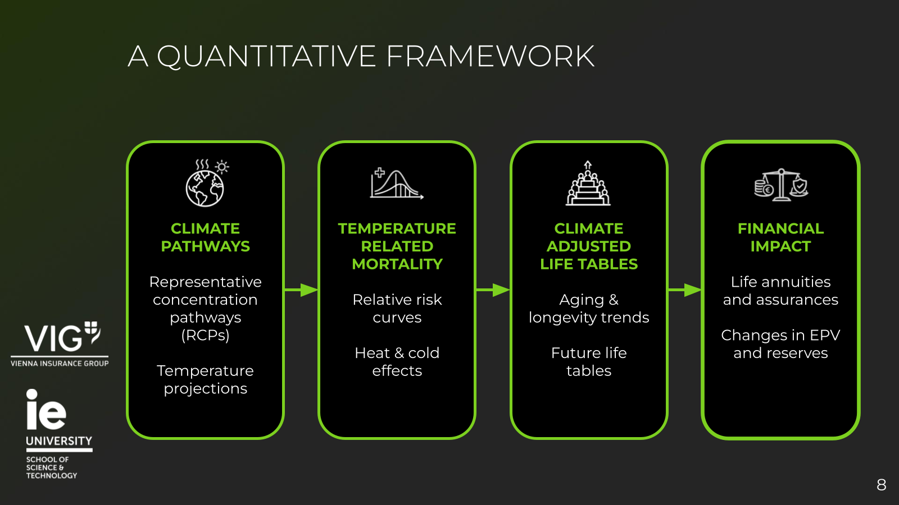
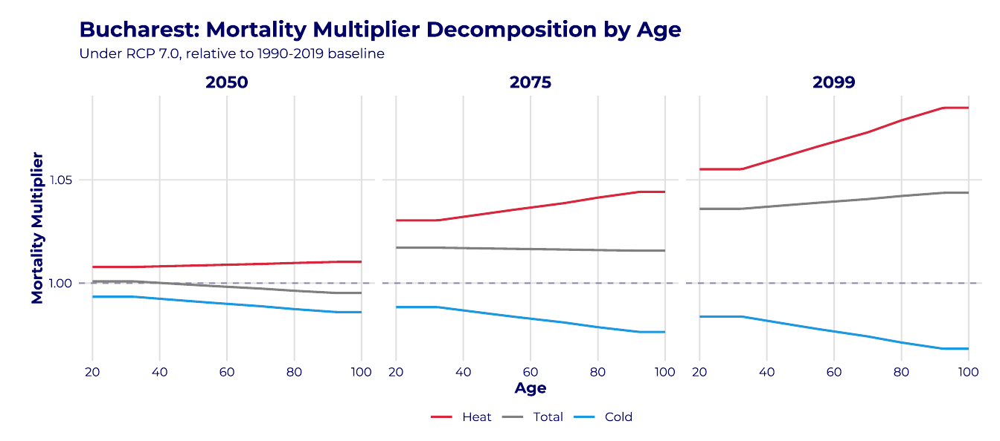
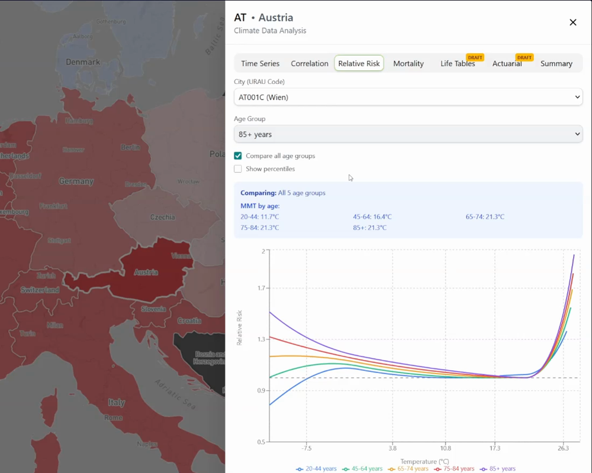
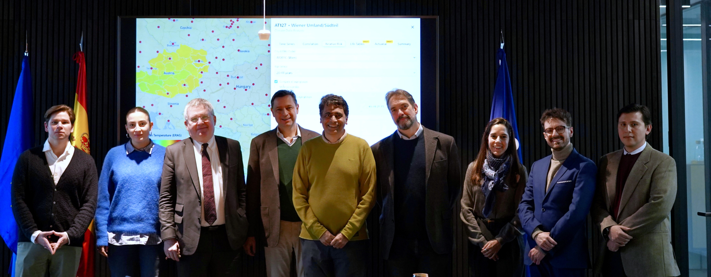

<h2>Who needed the work and why</h2>

Vienna Insurance Group (VIG) is a large insurance group in Central and Eastern Europe. Warmer weather affects mortality and health, which changes the assumptions behind life and health products and reserves. VIG and IE University set up the IE Insurance and Tech Lab in July 2025. Its first project is called "Climate Change Effects on Life and Health Insurance".

<h2>My role and the collaboration</h2>

This is an industry contract run as a research project inside my appointment at IE University. VIG is the client. David Gómez-Ullate, Vice Dean at IE University, works with me on the project. Phase 1 ran in 2025/26 and I was a member of the research team. Phase 2 runs in 2026/27, after the VIG board approved it in May 2026.

In phase 2, I lead the package on mortality related to temperature and air quality. I take responsibility for it. I develop the code, the dashboard, the reports and the presentations. I work on it as an individual contributor, with nobody reporting to me.

<h2>What I contributed</h2>
<ul>
  <li>Climate and mortality models that use distributed lag non-linear models and relative risk curves.</li>
  <li>Analysis pipelines that turn climate scenarios into mortality projections by region, age and year.</li>
  <li>An interactive dashboard for exploring scenarios. I demonstrated it at the Climate Change and Insurance workshop in Edinburgh in September 2025.</li>
  <li>Presentations to the VIG steering committee and to the VIG board in Vienna in May 2026.</li>
  <li>A member of the organising committee of the Climate Change and Insurance Conference 2026 at IE University.</li>
</ul>

<h2>Main challenge and approach</h2>
<figure>
  
  <figcaption>The framework in four steps. From a presentation at the Climate Change and Insurance Collider, September 2026.</figcaption>
</figure>

Insurers already have actuarial methods for life tables. The challenge is to add a temperature effect without breaking those methods, and to be clear about how uncertain it is. Our working paper adds the climate effect as a transparent multiplier on baseline mortality, by age and year, under climate scenarios. Uncertainty from the epidemiological estimates, the climate models and adaptation assumptions is carried through a Monte Carlo simulation to annuities, life insurance values and technical provisions.

<figure>
  
  <figcaption>Mortality multiplier by age in the illustrative Bucharest example, for 2050, 2075 and 2099.</figcaption>
</figure>

<h2>The dashboard</h2>

The public dashboard lets people explore temperature data and projections under moderate and high emissions pathways, air quality layers and the mortality multiplier, by place and week. The preview below is still until you press play.

<figure data-gif="/images/projects/vig/dashboard-preview.gif">
  
  <figcaption>An excerpt of the dashboard demonstration. <a href="https://dashboard.climateinsure.tech/">Open the live dashboard</a>.</figcaption>
</figure>

<h2>What was delivered</h2>
<ul>
  <li>An open working paper, "Incorporating Temperature-Dependent Mortality into Projected Life Tables" (IE University, 2026). I am the first author, with F. J. Suárez Pedraza, S. Lloyd, C. Boado-Penas and D. Gómez-Ullate.</li>
  <li>A public interactive dashboard, and results presented to VIG's steering committee several times and to its board once.</li>
</ul>

<h2>Results and limits</h2>
<ul>
  <li>The method is shown on one city, Bucharest, as an illustration. It is not a prediction for a portfolio.</li>
  <li>The paper is a working paper. It has not been peer reviewed.</li>
  <li>The board approved a one-year extension. Phase 2 adds air quality and mental health to the temperature work. Those results do not exist yet.</li>
</ul>
<figure>
  
  <figcaption>Steering committee of the IE Insurance and Tech Lab, January 2026.</figcaption>
</figure>

<h2>Evidence and links</h2>

  <a class="s-btn s-btn--ghost" href="https://doi.org/10.63537/144174297">Working paper</a>
  <a class="s-btn s-btn--ghost" href="https://dashboard.climateinsure.tech/">Dashboard</a>
  <a class="s-btn s-btn--ghost" href="https://climateinsure.tech/">Project website</a>
  <a class="s-btn s-btn--ghost" href="/posts/2026/vig-vienna-board">VIG board in Vienna</a>
  <a class="s-btn s-btn--ghost" href="/posts/2025/edinburgh">Edinburgh workshop</a>

