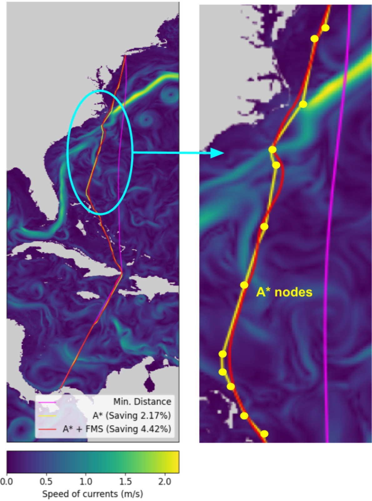
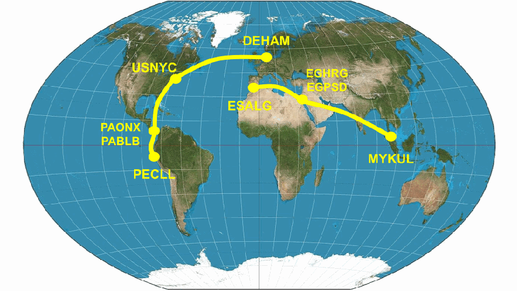
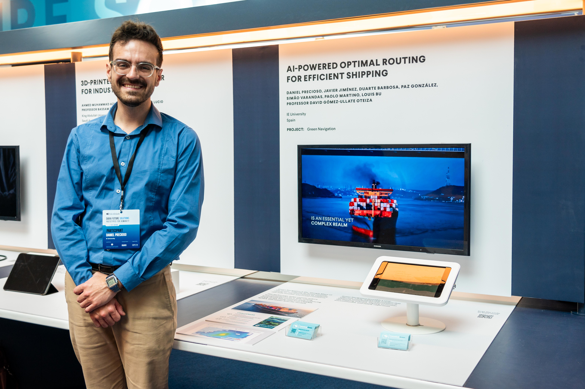

One project, from routing research to a startup and a shared benchmark. I work on choosing ship routes that account for wind, waves and currents to reduce fuel use and emissions.

<nav aria-label="In this case study"><ul class="cs__nav"><li><a href="#research">Routing research</a></li><li><a href="#startup">Canonical Green</a></li><li><a href="#benchmark">Open benchmark</a></li></ul></nav>

<h2>My role and the collaboration</h2>

The work started at UCA Datalab, University of Cádiz, as the Smart Shipping project. My supervisor David Gómez-Ullate suggested using the ocean current data from our fisheries work to route vessels. We developed the idea together, and I worked on it from the start. After my PhD the research continued at IE University in funded projects led by David Gómez-Ullate, where I am a team member.

<h2 id="research">Routing research</h2>

I co-developed HADAD and worked on the routing algorithms from the early Smart Shipping project. During a research stay at Dalhousie University, I adapted a variational method to Python and built the benchmarks for our hybrid search paper.

A route has to be found among millions of possible paths, with wind, waves and currents that change over time. HADAD works in two steps. It first searches a hexagonal grid with an A-star algorithm, which gives the ship more directions to choose from than a square grid. It then smooths the route in continuous space with a variational method. BERS, the newer method, searches with an evolutionary algorithm and refines the result with the same kind of variational step. It handles fixed arrival times.

<figure>
  
  <figcaption>A route from HADAD over ocean currents. The yellow nodes come from the graph search. The smooth line is the refined route.</figcaption>
</figure>

<h2 id="startup">Co-founding Canonical Green</h2>

In 2023 I co-founded Canonical Green to turn our routing research into software for ships. I am a board member and CTO; my initial role was COO. Green Navigation is the company’s weather-routing product.

I developed and ran the algorithms for a pilot with Boluda Towage through the Opentop acceleration programme. On the tested tugboat routes, simulations using validated consumption models showed about 10% lower GHG emissions. Boluda confirmed that the results matched its expectations. The pilot did not involve trials on a real vessel.

I pitched the project to the Missions València 2030 jury, where it ranked first and received a €93,362.84 grant. I also presented it at the European Parliament. In 2024, Green Navigation was selected for Prototypes for Humanity in Dubai, among 100 projects from more than 2,000 submissions.

<h2 id="benchmark">Creating an open Weather Routing Benchmark</h2>

I co-created the Weather Routing Benchmark with IE University and RISE Research Institutes of Sweden. It gives researchers shared test problems, open datasets and a public leaderboard so that routing methods can be compared on the same basis.

Eight teams took part in the first edition, held with the SWOPP3 workshop in 2026. I presented the results and our BERS method in Gothenburg. BERS combines evolutionary search with variational refinement and is a preprint under review.

The next steps are to extend the benchmark with harder cases, including uncertainty and Arctic routing. <a href="https://weatherrouting.org">Explore the benchmark and leaderboard &rarr;</a>

<h2>Results and limits</h2>
<ul>
  <li><strong>Pilot.</strong> GHG emissions fell by about 10% on the tugboat routes we tested, in simulation. Boluda confirmed the numbers matched their expectations. It was not tested on a real vessel.</li>
  <li><strong>HADAD.</strong> On a benchmark of 1,560 routes over a full year, it saved an extra 4% fuel on average compared with a pure graph search, measured against the shortest route. The savings were up to 27% in extreme weather. The average gain is much smaller than the peak.</li>
  <li><strong>BERS.</strong> It is a preprint under review. It was tested on synthetic cases and on 2024 ocean data for two ocean crossings.</li>
  <li><strong>Benchmark.</strong> The first edition compares methods on shared problems. It does not yet include uncertainty or Arctic routes.</li>
</ul>

<figure>
  
  <figcaption>Routes of the kind used in the benchmark. Image from the project presentation.</figcaption>
</figure>

<h2>Evidence and links</h2>
<figure>
  
  <figcaption>Green Navigation at Prototypes for Humanity, Dubai, 2024. It was selected among 100 innovations from more than 2,000 submissions.</figcaption>
</figure>

  <a class="s-btn s-btn--ghost" href="{{ page.paperurl }}">HADAD paper</a>
  <a class="s-btn s-btn--ghost" href="https://weatherrouting.org">Open benchmark</a>
  <a class="s-btn s-btn--ghost" href="https://arxiv.org/abs/2605.31533">BERS preprint</a>
  <a class="s-btn s-btn--ghost" href="https://canonicalgreen.com">Canonical Green</a>
  <a class="s-btn s-btn--ghost" href="/posts/2023/opentop-demo-day">Opentop Demo Day</a>

