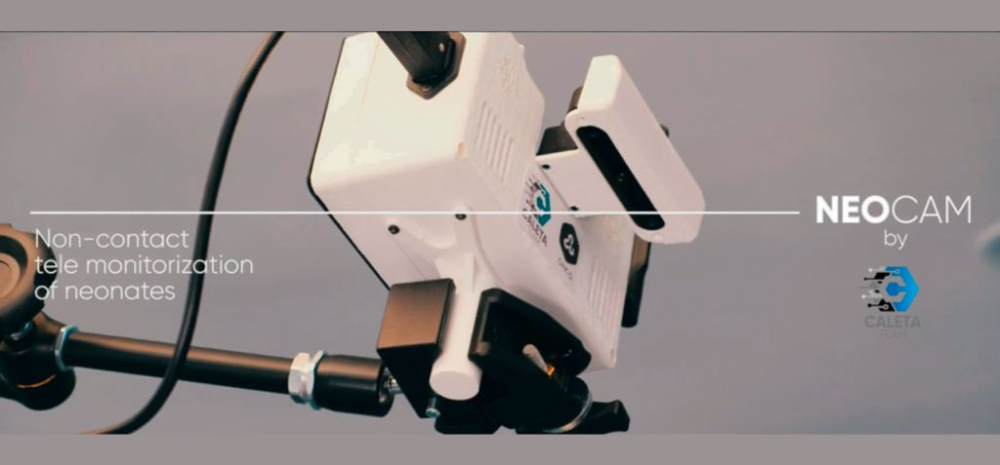
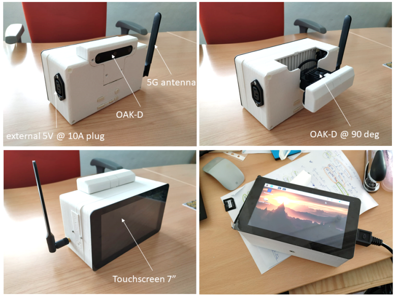
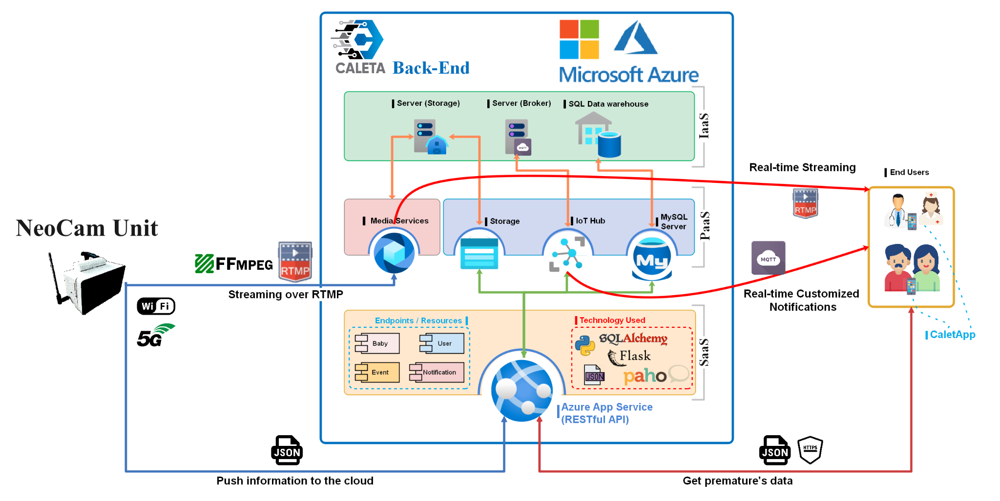
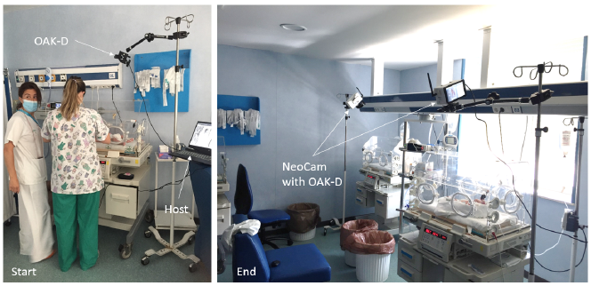

<figure>
  
  <figcaption>The NeoCam prototype. Frame from the Caleta Team presentation video.</figcaption>
</figure>

<h2>Who needed the work and why</h2>

Premature babies in intensive care need constant observation. Conventional monitors use sensors attached to the body. Movement and behaviour also carry information, but they are hard to follow all day and are often recorded by eye. The question was whether a camera could measure some of this without touching the baby.

<h2>My role and the collaboration</h2>

NeoCam was built by Caleta Team, a group at the University of Cádiz led by Lionel Cervera Gontard. It combined engineers, computer scientists and the neonatal team at Hospital Puerta del Mar. I worked in the AI part, at UCA Datalab, as one of several people. I am second author of the paper.

<h2>What I contributed</h2>
<table class="cs__facts">
  <tr><th>Python library</th><td>I built a part of the library that runs on the device.</td></tr>
  <tr><th>Movement</th><td>My idea. Pose models made for adults do not fit a newborn's proportions. I proposed two bounding boxes, one for the head and one for the body, and reading the baby's movement from how they shift.</td></tr>
  <tr><th>Breathing</th><td>I helped with estimating breathing from the depth camera. The idea was not mine.</td></tr>
  <tr><th>The rest</th><td>Hardware, cloud platform, mobile app, clinical testing and the other models were done by the team.</td></tr>
</table>

<h2>Challenge and approach</h2>

The analysis runs on the camera itself, an OAK-D that does colour imaging, stereo depth and neural network inference on the device. This keeps latency low and lets the images be anonymised before anything leaves the incubator. The published platform runs several tasks in parallel at 20 to 30 frames per second: breathing rate, movement and an experimental stress indicator. A Raspberry Pi 4 collects the outputs and sends them to a cloud platform and a mobile app.

<figure>
  
  <figcaption>The prototype: a compact housing with an adjustable OAK-D camera, an antenna and a seven inch touchscreen. Images from the project presentation.</figcaption>
</figure>
<figure>
  
  <figcaption>The edge-cloud architecture. Diagram from the project presentation.</figcaption>
</figure>

<h2>What was delivered</h2>
<ul>
  <li>A working prototype with on-device models, a cloud platform and a mobile app.</li>
  <li>A test in the neonatal intensive care unit of Hospital Puerta del Mar in Cádiz.</li>
  <li>A Spanish utility model for the device, granted to the team in 2023.</li>
  <li>A paper in the IEEE Journal of Biomedical and Health Informatics (2023).</li>
</ul>
<figure class="cs__fig--small">
  
  <figcaption>Testing at Hospital Puerta del Mar. The first camera-and-laptop setup, then the integrated unit. Images from the project presentation.</figcaption>
</figure>

<h2>Results and limits</h2>
<ul>
  <li>The paper reports agreement between video-based breathing estimates and reference methods under suitable lighting and imaging conditions.</li>
  <li>The stress indicator is experimental. It uses a face image classifier trained to tell stress from calm.</li>
  <li>NeoCam is a research prototype. It is not a certified medical device.</li>
  <li>Development continued after my involvement ended.</li>
</ul>

<h2>Evidence and links</h2>

  <a class="s-btn s-btn--ghost" href="{{ page.paperurl }}">IEEE JBHI paper</a>
  <a class="s-btn s-btn--ghost" href="https://opencv.org/announcing-the-grand-prize-winners-of-opencv-ai-competition-2021/">OpenCV prize announcement</a>
  <a class="s-btn s-btn--ghost" href="https://www.youtube.com/watch?v=cQ-Q-4QGRCo">OpenCV Weekly interview (video)</a>

